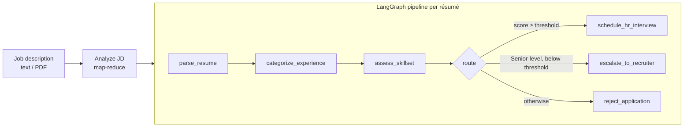

# 🎯 TalentGraph

**AI-powered résumé screening.** Upload a job description and a batch of PDF résumés; TalentGraph scores every candidate against the role, explains its reasoning, and routes each one to **shortlist**, **escalate to a recruiter**, or **reject**, using a [LangGraph](https://langchain-ai.github.io/langgraph/) workflow.

**Live demo:** <https://YOUR-APP.vercel.app> · **API docs:** <https://YOUR-API.onrender.com/docs>

> The demo runs on free hosting tiers. The first request after a period of inactivity can take 30–60 seconds while the backend wakes up.

---

## Features

- **Bulk screening:** up to 25 PDF or TXT résumés per run, processed concurrently in the background with live progress.
- **Long job descriptions:** paste text or upload a PDF. Large JDs are split into chunks and merged (map-reduce), so length is not a limit.
- **Structured JD analysis:** extracts the title, seniority, minimum experience, must-have skills and nice-to-have skills.
- **Explainable results:** each candidate gets a 0–100 fit score, matched and missing skills, strengths, concerns and written reasoning.
- **Actionable output:** tailored interview questions for shortlisted candidates and draft feedback for rejected ones.
- **Adjustable threshold:** tune the match cut-off from the UI and compare outcomes.
- **Run history:** every screening is stored in MongoDB; reopen or delete past runs.
- **Resilient by design:** per-file error isolation (one bad PDF never fails the batch), scanned-PDF detection, rate-limit-aware concurrency and automatic LLM retries.

## How it works



**Routing rules**

| Condition | Decision |
|---|---|
| Score ≥ threshold (default 70) | Shortlist, with interview questions |
| Below threshold and Senior-level | Escalate to a human recruiter |
| Below threshold and not Senior-level | Reject, with draft feedback |

Every LLM call returns a **Pydantic-validated structured object**, so routing never depends on parsing free text. The match decision is derived deterministically from the score.

## Architecture

```
React + Vite (Vercel) ──HTTPS──▶ FastAPI (Render) ──▶ LangGraph ──▶ Groq (gpt-oss-120b)
                                      │
                                      └──▶ MongoDB Atlas (batches, candidates)
```

Screening a batch takes minutes, so `POST /api/batches` returns `202 Accepted` with a batch ID immediately. The work runs in the background and the frontend polls for progress.

## Tech stack

| Layer | Technology |
|---|---|
| Frontend | React 18, Vite |
| Backend | FastAPI, Uvicorn, Pydantic |
| Orchestration | LangGraph, LangChain |
| LLM | Groq (`openai/gpt-oss-120b`) |
| PDF parsing | pypdf |
| Database | MongoDB Atlas (Motor async driver) |
| Hosting | Vercel (frontend), Render (backend) |

## Project structure

```
.
├── backend/
│   ├── app/
│   │   ├── main.py       # FastAPI routes, background batch runner
│   │   ├── graph.py      # LangGraph screening workflow
│   │   ├── jd.py         # Long-JD analysis (chunk + merge)
│   │   ├── pdf.py        # PDF/TXT text extraction
│   │   ├── llm.py        # Structured-output LLM helper
│   │   ├── schemas.py    # Pydantic models
│   │   ├── db.py         # MongoDB connection
│   │   └── config.py     # Environment configuration
│   ├── requirements.txt
│   └── .env.example
├── frontend/
│   ├── src/              # React app (App.jsx, api.js, styles.css)
│   └── .env.example
└── render.yaml           # Render blueprint
```

## Getting started

### Prerequisites

- Python 3.12+ and Node.js 18+
- A [Groq API key](https://console.groq.com/keys)
- A [MongoDB Atlas](https://www.mongodb.com/atlas) cluster (the free M0 tier is enough)

### 1. Backend

```bash
cd backend
python -m venv .venv
source .venv/bin/activate          # Windows: .venv\Scripts\activate
python -m pip install -r requirements.txt

cp .env.example .env               # then edit .env with your keys
export $(grep -v '^#' .env | xargs)    # macOS/Linux; loads variables into this shell

python -m uvicorn app.main:app --reload
```

Verify it at <http://localhost:8000/api/health>. You should see `{"status":"ok","db":"up"}`. Interactive API docs are at <http://localhost:8000/docs>.

### 2. Frontend

```bash
cd frontend
npm install
cp .env.example .env
npm run dev
```

Open <http://localhost:5173>.

## Configuration

**Backend** (`backend/.env`)

| Variable | Required | Default | Description |
|---|---|---|---|
| `GROQ_API_KEY` | Yes | — | Groq API key |
| `MONGODB_URI` | Yes | — | MongoDB Atlas connection string |
| `MONGODB_DB` | No | `talentgraph` | Database name |
| `GROQ_MODEL` | No | `openai/gpt-oss-120b` | Groq model ID |
| `CORS_ORIGINS` | No | `http://localhost:5173` | Comma-separated list of allowed frontend origins |
| `LLM_CONCURRENCY` | No | `3` | Max parallel LLM pipelines (tune to your Groq rate limit) |

**Frontend** (`frontend/.env`)

| Variable | Description |
|---|---|
| `VITE_API_URL` | Base URL of the backend, with no trailing slash |

## API reference

| Method | Endpoint | Description |
|---|---|---|
| `GET` | `/api/health` | Service and database status |
| `POST` | `/api/batches` | Start a screening run. `multipart/form-data` with `resumes` (files), `jd_text` or `jd_file`, and optional `threshold` (0–100). Returns `202` with `batch_id` |
| `GET` | `/api/batches` | List recent runs |
| `GET` | `/api/batches/{id}` | Run status, parsed JD and ranked candidates |
| `DELETE` | `/api/batches/{id}` | Delete a run and its candidates |

**Limits:** 25 résumés per run, 10 MB per file, PDF or TXT only. Scanned (image-only) PDFs are rejected with a clear message.

## Deployment

### MongoDB Atlas

1. Create a project and a free **M0** cluster.
2. **Database Access:** add a user with a password.
3. **Network Access:** allow `0.0.0.0/0`, because Render's free tier has no static IP.
4. **Connect → Drivers:** copy the connection string and substitute your password.

### Backend on Render

1. **New → Web Service**, then select this repository.
2. Settings:
   - **Root Directory:** `backend`
   - **Build Command:** `pip install -r requirements.txt`
   - **Start Command:** `uvicorn app.main:app --host 0.0.0.0 --port $PORT`
   - **Health Check Path:** `/api/health`
3. Environment variables: `PYTHON_VERSION=3.12.8`, `GROQ_API_KEY`, `MONGODB_URI`, `MONGODB_DB`, `CORS_ORIGINS`.

A `render.yaml` blueprint is included as an alternative.

### Frontend on Vercel

1. **Add New → Project**, then import this repository.
2. **Root Directory:** `frontend` (the Vite preset is detected automatically).
3. Environment variable: `VITE_API_URL=https://<your-service>.onrender.com`.

### Connect the two

Set `CORS_ORIGINS` on Render to your Vercel URL (for example `https://your-app.vercel.app`). Vite variables are baked in at build time, so redeploy the frontend whenever `VITE_API_URL` changes.

## Security and privacy

- Secrets live only in environment variables. `.env` files are git-ignored.
- **The demo has no authentication.** Anyone with the link can view runs. Do not upload real personal data to a public deployment; use synthetic résumés.
- Scoring prompts are limited to evidenced skills and experience. Automated output is decision support: the escalation path keeps a human recruiter in the loop, and final hiring decisions should always be made by people.

## Known limitations

- Runs execute inside the API process. A server restart mid-run leaves that run unfinished. A worker queue (Celery, RQ) would address this at scale.
- No OCR yet, so scanned résumés are not supported.
- LLM scoring is non-deterministic, so scores can vary slightly between runs.

## Roadmap

- [ ] OCR for scanned PDFs
- [ ] DOCX résumé support
- [ ] Authentication and per-user workspaces
- [ ] Embedding-based pre-filter for large applicant pools
- [ ] Persistent job queue and worker
- [ ] CSV/PDF export of shortlists
- [ ] Observability with LangSmith

## License

Released under the [MIT License](LICENSE).
